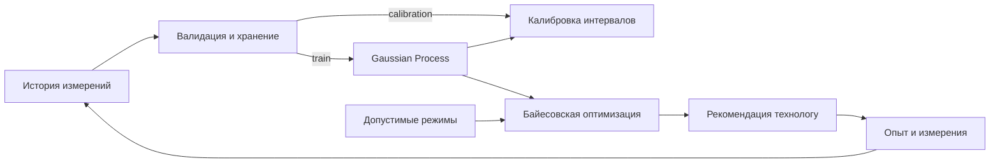

# PolySearch

**PolySearch (ранее SYURAI Polymer Lab)** — программная платформа интеллектуального планирования экспериментов по синтезу полимеров. Цель: находить режимы синтеза, обеспечивающие заданные свойства материала, при меньшем числе физических опытов.

> Статус репозитория: этап 7 — программный контур подготовки пилота; локальный интерфейс и архивная проверка Monash MMA v1; программное ядро v0.1.0. Реализована новая версия по спецификации проекта. Архивные исходники предшествующего демонстратора не переносились; результаты старых прогонов не подтверждают качество новой реализации.

## Задача

В разработке полимеров специалист задаёт параметры синтеза, проводит опыт, измеряет свойства и корректирует следующий план. Физические опыты требуют материалов, времени установки и лабораторных измерений. PolySearch предлагает последовательный план на основе истории опытов, прогноза свойств, неопределённости и технологических ограничений. Окончательное решение о проведении физического опыта принимает технолог.

## Как работает система



1. Пользователь задаёт управляемые факторы, целевые диапазоны и ограничения.
2. Загружает историю измерений (CSV) или вводит результаты вручную.
3. Модель прогнозирует свойства и их неопределённость для новых параметров.
4. Алгоритм рекомендует один или несколько новых допустимых опытов.
5. После получения результатов история обновляется, а следующий запрос рекомендаций переобучает модель.

## Технологический стек

| Компонент | По описанию v0.1.0 | Следующий этап |
|---|---|---|
| Регрессия | scikit-learn Gaussian Process | Ridge, CatBoost, при необходимости BoTorch |
| Оптимизация | Monte Carlo Expected Improvement, Latin Hypercube | qLogNEI, учёт стоимости и незавершённых опытов |
| Интервалы | GP, split conformal для отдельного свойства | Проверка группового покрытия |
| Backend | Python 3.11/3.12, FastAPI, Pydantic, SciPy, NumPy | Версии моделей, частичные измерения |
| Хранение | SQLite | Нормализованная схема, аудит, права |
| Интерфейс | HTML/CSS/JavaScript | Многопользовательский контур и интеграция с LIMS |

## Документация

| Документ | Содержание |
|---|---|
| [PRODUCT](docs/PRODUCT.md) | Проблема, пользователи, сценарии, границы продукта |
| [ARCHITECTURE](docs/ARCHITECTURE.md) | Модули и поток данных |
| [ML_ENGINE](docs/ML_ENGINE.md) | Модели, функция потерь, оптимизация, интервалы |
| [DATA](docs/DATA.md) | Данные, источники, контракт, ETL |
| [MONASH_ML](docs/MONASH_ML.md) | Протокол сравнения четырёх моделей |
| [MONASH_ML_RESULTS](docs/MONASH_ML_RESULTS.md) | Фактические результаты на 15 группах MMA |
| [MONASH_BO](docs/MONASH_BO.md) | Архивный протокол последовательного выбора |
| [MONASH_BO_RESULTS](docs/MONASH_BO_RESULTS.md) | Результаты пяти стратегий и анализ чувствительности |
| [WEB_UI](docs/WEB_UI.md) | Локальное рабочее пространство исследователя |
| [PILOT](docs/PILOT.md) | Кампании, согласование, снимки модели, учёт затрат |
| [API](docs/API.md) | Контракты API и примеры запросов |
| [IMPLEMENTATION](docs/IMPLEMENTATION.md) | Запуск новой реализации и текущие ограничения |
| [VALIDATION](docs/VALIDATION.md) | Тесты, benchmark, проверка на реальных данных |
| [ROADMAP](docs/ROADMAP.md) | Этапы разработки и критерии готовности |
| [STATUS](docs/STATUS.md) | Разграничение заявленной готовности и планов |
| [PROJECT_MAP](docs/PROJECT_MAP.html) | Интерактивная техническая карта (публичная версия, скачать и открыть локально) |

## Текущий результат и ограничения

По предоставленной документации, в v0.1.0 реализованы CSV-импорт, GP-регрессия, подбор кандидатов, проверка ограничений, синтетический симулятор, хранение истории и локальный интерфейс. Указаны 18 пройденных тестов. На одной искусственной задаче при бюджете 24 опыта и 20 запусках GP-стратегия достигла цели 20/20, random — 1/20, LHS — 0/20. Эти числа не проверены повторным запуском в данном репозитории и не свидетельствуют об экономии реальных синтезов.

На открытом Monash MMA v1 подготовлено 785 измерений из 15 групп условий (provisional). Групповой CV четырёх моделей показал наименьший group macro MAE у Ridge: 3,214 п.п.; кинетическая модель — 3,256 п.п.; CatBoost — 3,788 п.п.; GP — 4,864 п.п. См. [результаты](docs/MONASH_ML_RESULTS.md). Это внешний CV по группам, а не подтверждение промышленной экономии. В архивном BO сравнили пять стратегий на одинаковых начальных наборах. На полном пуле Ridge дал 21,61% средней лучшей конверсии после пяти реакций против 18,17% у random. После исключения двух реакций с возможными скачками цель 15% стала недостижима; максимум 13,32%. [Результаты BO](docs/MONASH_BO_RESULTS.md). Добавлен локальный интерфейс и отдельный контур подготовки пилота: фиксированный протокол, согласование планов, изолированные ветки, снимки расчётов, реальные измерения и затраты. Физический пилот не проведён; данные Monash пока provisional.

## Разработка

Python 3.11 или 3.12. Запуск на Linux/macOS:

```bash
git clone https://github.com/Timur-marii8st/PolySearch.git
cd PolySearch
python -m venv .venv
source .venv/bin/activate
python -m pip install -e ".[dev]"
python -m pytest -q
python -m uvicorn polysearch.api:create_app --factory --host 127.0.0.1 --port 8000
```

Откройте http://127.0.0.1:8000/ для работы в интерфейсе. Swagger по http://127.0.0.1:8000/docs остаётся доступным. Подробности — [IMPLEMENTATION](docs/IMPLEMENTATION.md). 52 автоматических теста и проверки пилотных кампаний пройдены на обеих версиях Python и CI для Python 3.11/3.12; результат проверяется в [Actions](https://github.com/Timur-marii8st/PolySearch/actions). ETL Monash v1 и воспроизводимый ML-бенчмарк успешно выполнены на фактических данных через GitHub Actions; предварительная химическая разметка требует экспертной проверки. См. [DATA](docs/DATA.md) и [Monash](data/monash/README.md). Для ML-бенчмарка установите `pip install -e ".[ml]"` и следуйте [MONASH_ML](docs/MONASH_ML.md). Архивный BO воспроизводится командой `python -m polysearch.bo.replay` после ETL, согласно [протоколу](docs/MONASH_BO.md). Веб-интерфейс доступен локально; Chromium smoke-тест основного интерфейса и пилотной кампании пройден. Кампании открываются по http://127.0.0.1:8000/pilot (нужна конфигурация реального проекта); [PILOT](docs/PILOT.md). См. [WEB_UI](docs/WEB_UI.md). См. [дорожную карту](docs/ROADMAP.md) и [правила внесения изменений](CONTRIBUTING.md).

Лицензия и права на существующую реализацию не определены в предоставленных материалах. Не публиковать закрытый код и данные без согласования с правообладателями.
