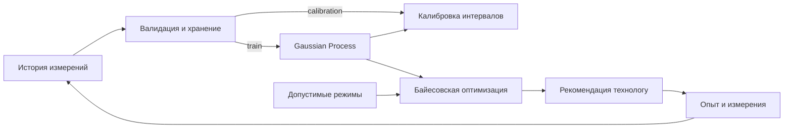

# PolySearch

**PolySearch (ранее SYURAI Polymer Lab)** — программная платформа интеллектуального планирования экспериментов по синтезу полимеров. Цель: находить режимы синтеза, обеспечивающие заданные свойства материала, при меньшем числе физических опытов.

> Статус репозитория: этап 1 — документация. Описанный локальный демонстратор v0.1.0 существует согласно предоставленной карте проекта; его исходники и результаты прогонов в этот репозиторий пока не перенесены. Документация не является доказательством промышленной эффективности.

## Задача

В разработке полимеров специалист задаёт параметры синтеза, проводит опыт, измеряет свойства и корректирует следующий план. Физические опыты требуют материалов, времени установки и лабораторных измерений. PolySearch предлагает последовательный план на основе истории опытов, прогноза свойств, неопределённости и технологических ограничений. Окончательное решение о проведении физического опыта принимает технолог.

## Как работает система

1. Пользователь задаёт управляемые факторы, целевые диапазоны и ограничения.
2. Загружает историю измерений (CSV) или вводит результаты вручную.
3. Модель прогнозирует свойства и их неопределённость для новых параметров.
4. Алгоритм рекомендует один или несколько новых допустимых опытов.
5. После получения результатов история обновляется, а следующий запрос рекомендаций переобучает модель.

## Технологический стек

| Компонент | По описанию v0.1.0 | Следующий этап |
|---|---|---|
| Регрессия | scikit-learn Gaussian Process | Ridge, CatBoost, при необходимости BoTorch |
| Оптимизация | Monte Carlo Expected Improvement, Latin Hypercube | qLogNEI, учёт стоимости и незавершённых опытов |
| Интервалы | GP, split conformal для отдельного свойства | Проверка группового покрытия |
| Backend | Python 3.11/3.12, FastAPI, Pydantic, SciPy, NumPy | Версии моделей, частичные измерения |
| Хранение | SQLite | Нормализованная схема, аудит, права |
| Интерфейс | HTML/CSS/JavaScript | Многопользовательский контур и интеграция с LIMS |

## Документация

| Документ | Содержание |
|---|---|
| [PRODUCT](docs/PRODUCT.md) | Проблема, пользователи, сценарии, границы продукта |
| [ARCHITECTURE](docs/ARCHITECTURE.md) | Модули и поток данных |
| [ML_ENGINE](docs/ML_ENGINE.md) | Модели, функция потерь, оптимизация, интервалы |
| [DATA](docs/DATA.md) | Данные, источники, контракт, ETL |
| [API](docs/API.md) | Контракты и состояние по карте v0.1.0 |
| [VALIDATION](docs/VALIDATION.md) | Тесты, benchmark, проверка на реальных данных |
| [ROADMAP](docs/ROADMAP.md) | Этапы разработки и критерии готовности |
| [STATUS](docs/STATUS.md) | Разграничение заявленной готовности и планов |
| [PROJECT_MAP](docs/PROJECT_MAP.html) | Интерактивная техническая карта (публичная версия, скачать и открыть локально) |

## Текущий результат и ограничения

По предоставленной документации, в v0.1.0 реализованы CSV-импорт, GP-регрессия, подбор кандидатов, проверка ограничений, синтетический симулятор, хранение истории и локальный интерфейс. Указаны 18 пройденных тестов. На одной искусственной задаче при бюджете 24 опыта и 20 запусках GP-стратегия достигла цели 20/20, random — 1/20, LHS — 0/20. Эти числа не проверены повторным запуском в данном репозитории и не свидетельствуют об экономии реальных синтезов.

Первый научный этап — проверка на открытом наборе Monash: один мономер, прогноз конверсии по температуре, отношению агента переноса цепи к мономеру (CT/CM) и времени пребывания. Затем — проверка последовательного выбора на архиве реальных опытов и пилот с технологом.

## Разработка

На текущем этапе репозиторий содержит только документацию. Команды запуска, зависимости, CI и исполняемые компоненты будут добавлены при переносе или реализации исходного кода. См. [дорожную карту](docs/ROADMAP.md) и [правила внесения изменений](CONTRIBUTING.md).

Лицензия и права на существующую реализацию не определены в предоставленных материалах. Не публиковать закрытый код и данные без согласования с правообладателями.
