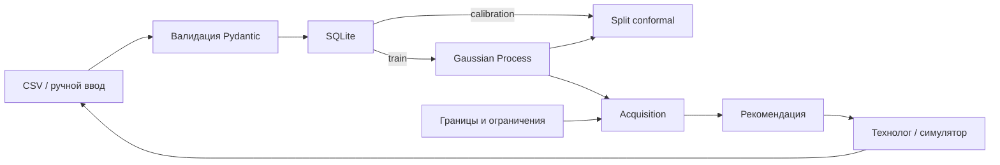

# Архитектура

Ниже описана схема демонстратора v0.1.0 по карте проекта. Исходники ещё не загружены.

| Модуль | Назначение |
|---|---|
| Data | Атомарный импорт CSV и экспорт истории |
| Schema | Численные значения, уникальные имена, диапазоны, статусы |
| Storage | FastAPI, SQLite, журнал, revision, recommendation ID |
| GP | Независимый регрессор для каждого свойства |
| Constraints | Проверка допустимой области и генерация кандидатов |
| Acquisition | Ожидаемое улучшение целевой функции |
| Uncertainty | Калибровка интервалов на отдельной выборке |
| Feedback | Запись измерения, инвалидирование рекомендаций |

После добавления результата старая рекомендация недействительна. Новый запрос обучает модель заново; фонового обучения нет. Калибровочные метки не участвуют в fit или acquisition.

## План развития
Нормализованная БД, provenance исходных данных, частичные измерения, версии моделей, права пользователей, согласованный LIMS-адаптер. Интеграция с установкой — только после пилота. Не считать линейные математические ограничения доказательством физической безопасности.
