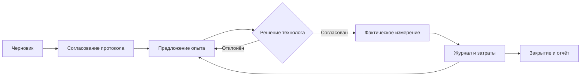

# Подготовка независимого пилота PolySearch

Это программный контур учёта, согласования и сравнения. Физический пилот ещё не проведён. Не является системой управления установкой, сертификатом безопасности или доказательством экономии.

## Протокол до начала

Создать реальный проект в обычном workspace: факторы, единицы, диапазоны, целевые свойства и линейные ограничения. Затем сформировать отдельную кампанию. Она копирует конфигурацию и, только при явном выборе, общий исторический набор с описанием происхождения. Синтетические записи запрещены. Исторический набор — общий для обеих веток; его затраты не входят в перспективный бюджет. Данные, собранные в одной ветке пилота, не используются моделью другой. Кривые Monash не импортировать как независимые синтезы.

Технолог и заказчик заранее определяют цель, независимую экспериментальную единицу, правила измерений и QC, ограничения и процедуру остановки, способ формирования baseline (ручной выбор по утверждённому протоколу), одинаковый лимит попыток на ветку, число подтверждающих независимых повторов, валюту и правила включения стоимости. Записать ответственное лицо и основание допуска. Не указывать реальные опасные параметры по умолчанию. Согласование в программе — запись имени/комментария, не ЭП, не аутентификация, не техническая проверка безопасности.

## Жизненный цикл

Для каждой ветки одновременно допускается только один открытый план. Baseline задаётся человеком; PolySearch предлагает независимый GP либо начальный план по данным только своей ветки и общей истории. Архивный Ridge/GP-EI модуль пока отдельно. Повтор — явное действие с ссылкой на предыдущий завершённый непротиворечивый опыт. Все физические попытки учитываются, в том числе failed, отклонения и подтверждения. Отклонение до проведения не расходует лимит. Фактические параметры и исходы записываются отдельно; отклонение требует пояснения и исключается из обучения и подтверждения цели, но не из расходов. При failed причина обязательна. После закрытия записи не редактируются через API.

## Воспроизводимость и отчёт

Для каждой ML-рекомендации хранится снимок конфигурации, полной доступной на момент расчёта истории (включая ID), параметров поиска, версии Python/библиотек, хешей исходников и отчёта модели. SHA256 идентифицирует снимок. Replay проверяет целостность, совпадение окружения и параметров/score с допуском, отдельно exact hash кандидата. Не хранится сериализованный GP; хеш не заменяет полноценную систему версионирования артефактов. Цепочка событий с хешами обнаруживает случайные изменения, но не защищена от переписывания БД администратором. База локальная, один процесс, оптимистическая проверка revision на всех изменениях.

Цель подтверждается заданным количеством завершённых непротиворечивых опытов с одинаковыми фактическими параметрами, все свойства должны удовлетворять целевым диапазонам. Первое подтверждение и накопленные к этому моменту стоимость, длительность и число попыток фиксируются отдельно для каждой ветки. Длительность — сумма сообщённых длительностей, не календарное время до результата; стоимость вводится в сотых долях валюты (RUB: копейки). Сравнение формируется только если обе ветки достигли подтверждённой цели; незавершённые/неуспешные ветки не получают выдуманную экономию. Отчёт описательный, без статистической значимости или причинного вывода; фактическая независимость повторов и соблюдение baseline должны подтверждаться внешним протоколом. Данные могут быть конфиденциальны, не коммитить рабочую SQLite/выгрузки.

## API

GET/POST /api/pilot/campaigns; GET /api/pilot/campaigns/{id}; POST .../activate; POST .../plans; POST .../plans/{plan_id}/review; POST .../plans/{plan_id}/measurement; POST .../close; GET .../report, .../export.json, .../attempts.csv, .../plans/{plan_id}/replay. Изменяющие запросы после создания требуют expected_revision и actor. Swagger /docs. UI /pilot.

## Что требуется для реального пилота

Заказчик, согласованный протокол испытаний и методика сравнения, реальная история и допуск специалиста; отдельные проспективные независимые реакции. Предварительные Monash-результаты не дают права утверждать экономию. До внешнего развёртывания нужны авторизация, разграничение полномочий, резервное восстановление, защита данных и контроль изменений.
